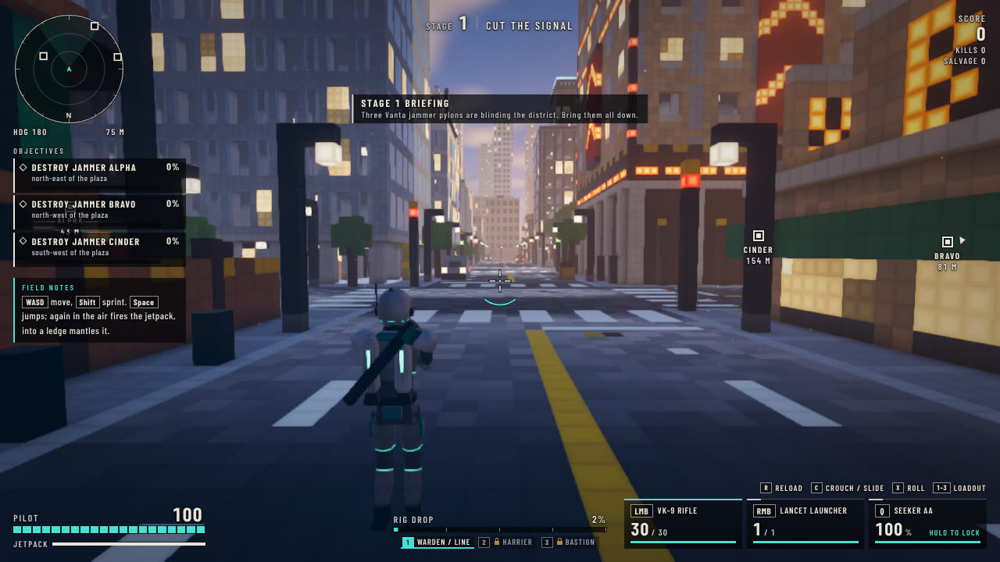
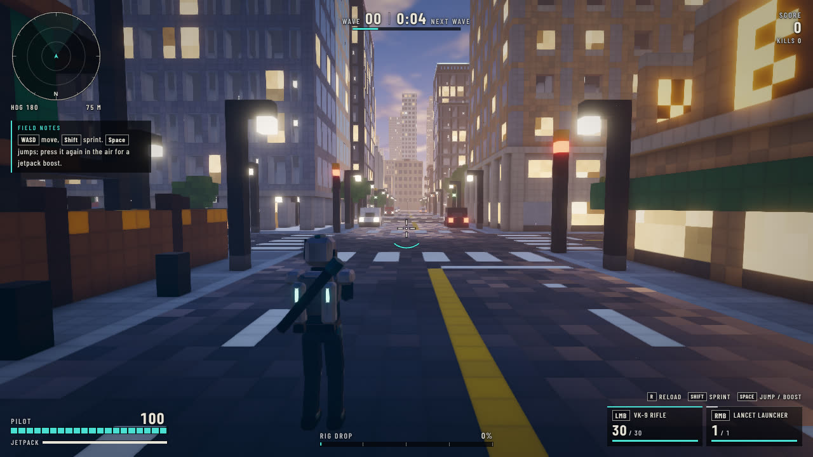
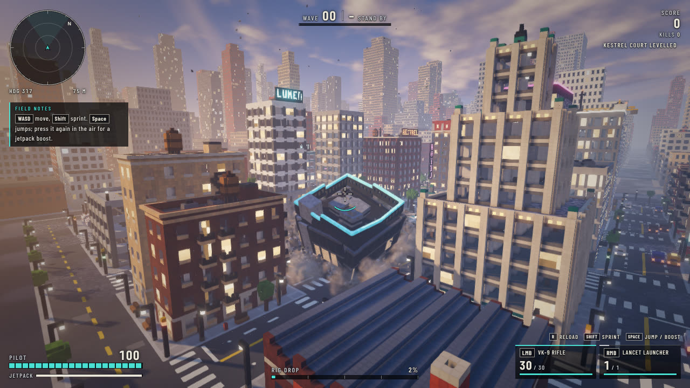
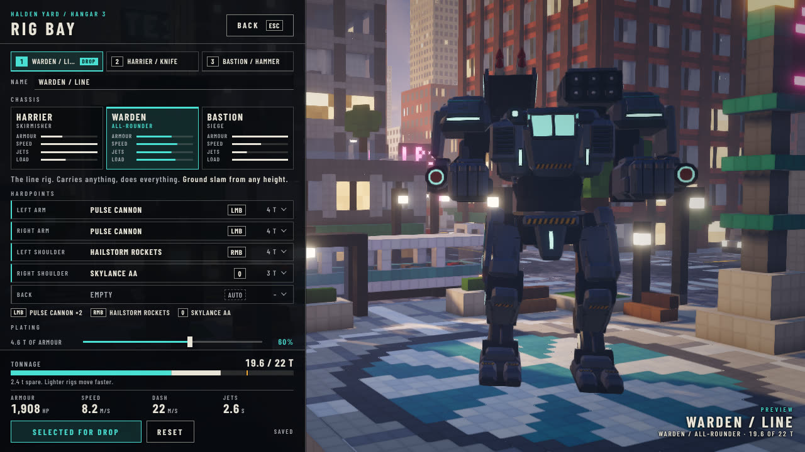

# Kiloton

Third-person rig combat in a fully destructible voxel city, playable in a browser.

**Play:** https://kiloton.assembll.xyz

A game design by Cam Smith, built with Claude over two days.

**Watch:** [82-second explainer](video/kiloton-explainer.mp4) on how it was built and what it does (no sound).



## What it is

You start on foot as a rig pilot with a rifle, a rocket launcher and a lock-on launcher. Kills fill a meter;
when it is full you call your rig down from orbit onto the spot you are aiming at, board it, and fight on in
8-metre armour. Every building in the district is a hollow structural frame of half-metre voxels. Take out
the supports and it comes down, the rubble stays where it lands, and anything underneath is crushed.

| | |
|---|---|
|  |  |
| On foot in Halden Yard | A 47 m tower after its ground floor is blown out |

- **Two modes.** Survival is endless escalating waves. Operation Blackout is a four-stage mission: fell
  three jammer pylons, hold a relay, breach a fortified command post, and kill the Dreadnought, a 17 m boss.
- **The Rig Bay.** Three chassis (Harrier, Warden, Bastion), five hardpoints, a tonnage limit, plating and
  paint. Weapons include pulse cannons, an autocannon, a cutting beam, a siege cannon, rocket and missile
  racks and a mortar; equipment includes an energy shield, a grapple claw, repair nanites and a jet booster.
- **Movement on foot.** Sprint, slide, crouch, combat roll, mantle, jetpack, and cover you can shoot over.
- **Destruction that matters.** Structural collapse, spreading fire, gas mains that chain along a street,
  fuel tankers, and rigs that can punch a wall onto whatever is behind it.
- **Co-op.** Up to four players in a browser tab. One player hosts, the others join with a four-letter
  code, and destruction is kept in sync between them.



## Controls

| Key | On foot | In the rig |
|---|---|---|
| WASD / mouse | Move / aim | Move / aim |
| Shift | Sprint | Dash |
| Space | Jump, jetpack, mantle | Jump jets |
| C | Crouch; slide while sprinting | Chassis ability (slam / brace) |
| X | Combat roll | Hold to eject |
| LMB / RMB / Q | Rifle / launcher / lock-on launcher | Fire groups 1 / 2 / 3 |
| G, T | | Arm equipment (shield, grapple) |
| F | | Punch, shield bash, finisher |
| E | Board rig; plant a charge on an enemy rig | Grab / throw |
| V | Call the rig drop | |
| 1 / 2 / 3 | Choose which loadout drops | |
| Esc | Pause | Pause |

Add `?unlock=1` to the address to open every chassis and module.

## How it is made

Everything is code. The game is three.js on WebGL 2, bundled by esbuild into a single HTML page of about
1.5 MB. There are no image, model or audio files: geometry, textures, effects, sound and music are all
generated procedurally at run time.

It was built by one lead and a set of specialist agents working in parallel, each owning one system:

1. The lead wrote the shared core (voxel grid, collision, input, entity registry, boot loop) and a written
   contract defining every module's API, the event bus, file ownership and performance budgets.
2. Each agent replaced one placeholder module with the real thing: city, render, destruct, fx, audio,
   models, combat, player, enemy, ui, and later mission and net.
3. Each agent built its own test harness, took screenshots of its work in a headless browser, critiqued
   them and iterated before reporting back.
4. The lead integrated, play-tested by fast-forwarding the simulation, fixed what broke and published.

The contracts are in [`docs/`](docs/): [`CONTRACT.md`](docs/CONTRACT.md) (the base game),
[`CONTRACT-B.md`](docs/CONTRACT-B.md) (Rig Bay and world depth), [`CONTRACT-C.md`](docs/CONTRACT-C.md)
(missions and progression) and [`CONTRACT-D.md`](docs/CONTRACT-D.md) (co-op). Each agent's own notes on
what it built, its debug hooks, measurements and known issues are in [`notes/`](notes/).

## Repository layout

| Path | What it holds |
|---|---|
| `src/` | The game, about 23,000 lines. `core.js`, `voxels.js`, `materials.js`, `boot.js`, `rigs.js` and `progress.js` are the shared core; every other file belongs to one module (`render_*.js`, `destruct_*.js`, and so on). |
| `src/baseline/` | Minimal reference implementation of every module, used by test harnesses. |
| `harness/` | Per-module test pages and scripts. |
| `server/` | The co-op relay (Bun, WebSocket rooms) and its Fly deploy script. |
| `tools/` | `shot.mjs` (headless screenshots) and `web.mjs` (wraps the build as a web page). |
| `docs/` | The design contracts and README images. |
| `notes/` | Per-module notes written by the agent that built each one. |

## Build and run

```bash
npm install
```

```bash
node build.mjs && node tools/web.mjs
```

That writes `public/index.html`. Open it in a current desktop browser; single player works from a local
file. For co-op, run the relay and point the game at it:

```bash
node_modules/.bin/bun run server/server.ts
```

Then open the page with `?relay=ws://127.0.0.1:8080/ws`.

Useful query parameters: `auto=1` (skip the title), `q=low|med|high`, `mech=1`, `loadout=0|1|2`, `wave=N`,
`mode=operation`, `stage=N`, `god=1`, `noenemy=1`, `unlock=1`.

## Status and known limits

- Desktop browsers with a mouse and keyboard only.
- Most testing was automated: scripted runs in a headless browser on a software GPU. Frame rate on real
  hardware, mouse feel, sound and difficulty have had little human testing.
- Co-op passed automated tests with two to four players against a local relay. It supports four players,
  the host's browser runs the simulation, and late joining is not supported.
- In co-op, a rig knocked into a wall and finisher animations are decided on the acting player's machine
  and can differ slightly from the host's view.

## Licence

MIT. See [`LICENSE`](LICENSE).
